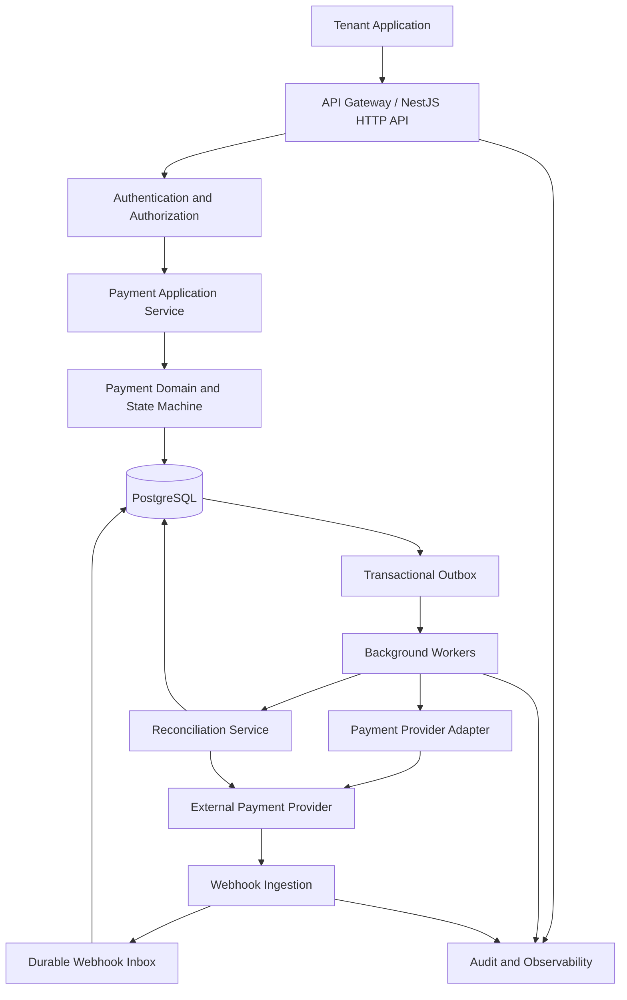

# Baloot Pay

> **Secure payment orchestration and transaction operations platform**

Baloot Pay is a backend-first payment operations platform designed to coordinate payment transactions, integrate with external payment service providers, manage transaction lifecycles, and provide reliable, auditable payment workflows for modern digital businesses.

**Built with:** NestJS · TypeScript · PostgreSQL · Prisma · Payment Provider APIs

**Organization:** Balootix

---

## Table of Contents

1. [Project Vision](#1-project-vision)
2. [Product Scope and Boundaries](#2-product-scope-and-boundaries)
3. [Engineering Principles](#3-engineering-principles)
4. [Technology Stack](#4-technology-stack)
5. [High-Level Architecture](#5-high-level-architecture)
6. [Repository Structure](#6-repository-structure)
7. [Core Domain Model](#7-core-domain-model)
8. [Financial Correctness and Invariants](#8-financial-correctness-and-invariants)
9. [Payment Lifecycle and State Machines](#9-payment-lifecycle-and-state-machines)
10. [API Design](#10-api-design)
11. [Security Architecture](#11-security-architecture)
12. [Reliability and Distributed Workflows](#12-reliability-and-distributed-workflows)
13. [Implementation Roadmap](#13-implementation-roadmap)
14. [Testing Strategy](#14-testing-strategy)
15. [Observability and Operations](#15-observability-and-operations)
16. [Deployment and Infrastructure](#16-deployment-and-infrastructure)
17. [Copilot Agent Instructions](#17-copilot-agent-instructions)
18. [Definition of Done](#18-definition-of-done)
19. [Documentation and Standards](#19-documentation-and-standards)
20. [Production Readiness Checklist](#20-production-readiness-checklist)

---

# 1. Project Vision

Baloot Pay aims to provide a reliable abstraction layer between digital businesses and payment providers.

Instead of coupling business applications directly to individual payment provider APIs, Baloot Pay exposes a consistent internal payment interface and manages the operational complexity of payment processing.

The platform should make it possible to:

- Create and track payment transactions.
- Integrate multiple payment providers through a consistent adapter interface.
- Support payment authorization, capture, cancellation, and refunds where the provider supports them.
- Handle asynchronous payment notifications safely.
- Prevent duplicate operations and unintended duplicate charges.
- Track transaction state changes through an auditable history.
- Recover from timeouts, network failures, and worker interruptions.
- Reconcile internal transaction records against provider records.
- Support multiple business tenants with strict data isolation.
- Provide operational visibility into failed, delayed, and inconsistent transactions.
- Offer a stable API that hides provider-specific implementation details.

The central objective is not simply to make payment requests succeed.

It is to make payment operations **correct, traceable, recoverable, secure, and understandable even when external systems fail**.

## 1.1 Product principles

Every architectural decision must prioritize these properties:

| Property | Requirement |
|---|---|
| Financial correctness | No silently duplicated or incorrectly represented financial operations. |
| Idempotency | Retrying an operation must not unintentionally execute it twice. |
| Security | Sensitive data and operations are protected by default. |
| Tenant isolation | One tenant cannot access another tenant's resources. |
| Reliability | Failures are explicitly represented and recoverable. |
| Auditability | Important state changes have attributable, durable records. |
| Extensibility | New payment providers do not require rewriting domain logic. |
| Observability | Operators can investigate failures without accessing sensitive payment data. |
| Maintainability | Modules have clear responsibilities and controlled dependencies. |

---

# 2. Product Scope and Boundaries

## 2.1 Initial product scope

The initial release should implement a payment orchestration service with a provider-independent domain model.

The platform will be responsible for coordinating operations, maintaining its internal transaction records, processing provider responses, handling webhooks, and reconciling discrepancies.

Actual money movement remains the responsibility of the integrated payment provider or other appropriately authorized financial institution.

### Included in the initial roadmap

- Tenant and API credential management.
- Payment creation and retrieval.
- Provider adapter abstraction.
- Payment status tracking.
- Provider-hosted checkout or provider token-based payment flows.
- Idempotent API operations.
- Authenticated and verified webhooks.
- Refund workflows.
- Authorization and capture where supported.
- Background job processing.
- Transaction event history.
- Reconciliation workflows.
- Operational dashboards or administrative APIs.
- Audit logs, metrics, structured logging, and alerts.
- Development, test, staging, and production configurations.

Individual payment methods and provider capabilities must be enabled only when explicitly selected and verified against the provider's documentation.

## 2.2 Explicitly excluded until separately approved

The initial release must not assume that Baloot Pay is authorized or designed to:

- Hold or custody customer funds.
- Maintain spendable customer balances.
- Operate as a bank, wallet, or stored-value institution.
- Issue payment cards.
- Store raw card numbers, CVVs, PINs, or magnetic-stripe data.
- Perform card acquiring independently of an authorized provider.
- Execute arbitrary bank transfers or payouts.
- Provide lending, credit, or investment products.
- Implement cryptocurrency custody.
- Make automated fraud decisions without an approved risk policy.

These are not ordinary feature additions. They may change the legal, security, operational, and accounting requirements of the entire platform.

## 2.3 Decisions that must not be guessed

Before implementing provider-dependent or jurisdiction-dependent functionality, document the following:

- Initial country of operation and applicable jurisdictions.
- Supported transaction currencies.
- Initial payment provider and supported payment methods.
- Merchant-of-record and settlement responsibilities.
- Whether Baloot Pay serves one merchant or multiple independent tenants.
- Authentication model for tenant applications and administrative users.
- Expected transaction volume and latency requirements.
- Data retention and deletion requirements.
- Applicable PCI DSS scope and validation obligations.
- Applicable privacy, consumer protection, financial services, and reporting obligations.

Use explicit configuration and capability flags for approved decisions.

Do not invent provider capabilities, legal conclusions, settlement guarantees, or financial behavior to keep implementation moving.

---

# 3. Engineering Principles

These principles are mandatory throughout development.

## 3.1 Modular monolith first

Build a modular NestJS application with explicit domain boundaries.

Do not introduce microservices solely to make the architecture appear more sophisticated.

Separate deployment processes may be used for the HTTP API, webhook ingestion, background workers, and scheduled reconciliation tasks while initially sharing the same codebase and PostgreSQL database.

## 3.2 PostgreSQL is the source of truth

Persist authoritative internal transaction state in PostgreSQL.

Do not use an in-memory cache, Redis, an external provider response, or a message broker as the only durable record of a financial operation.

External providers remain authoritative for their own processing outcomes. Baloot Pay must preserve the distinction between its local records and the provider's confirmed state.

## 3.3 Explicit domain behavior

Keep business rules inside application and domain services rather than controllers, Prisma middleware, or provider-specific HTTP handlers.

All state transitions must be validated by domain logic.

## 3.4 Fail closed

When authorization, webhook verification, amount validation, currency validation, or transaction ownership cannot be established, reject the operation or place it into a safe, explicitly defined recovery state.

Never guess a financial outcome.

## 3.5 Security and correctness before convenience

Do not weaken validation, remove authorization checks, bypass tests, or silently accept inconsistent financial data to make a feature easier to implement.

## 3.6 No unreviewed abstractions

Avoid speculative frameworks, unnecessary design patterns, and excessive indirection.

Every module and abstraction must serve a documented business or engineering requirement.

---

# 4. Technology Stack

| Layer | Technology | Responsibility |
|---|---|---|
| Language | TypeScript | Strongly typed application logic |
| Backend framework | NestJS | Modules, dependency injection, controllers and application services |
| Database | PostgreSQL | Durable transactional state |
| ORM | Prisma | Database access, schema management and migrations |
| API documentation | OpenAPI / Swagger | Versioned API contracts |
| Validation | NestJS-compatible DTO validation | Input validation and strict request schemas |
| Authentication | Approved authentication and credential model | Secure identity and access control |
| Background processing | Durable queue or PostgreSQL-backed work queue | Asynchronous workflows and retries |
| Testing | Jest and HTTP integration testing | Unit, integration and end-to-end verification |
| API protection | Rate limiting, throttling and abuse controls | Resource and business-flow protection |
| Observability | Structured logs, metrics and distributed tracing | Operational diagnosis |
| Containers | Docker | Consistent build and deployment environments |
| CI/CD | Repository-supported pipeline | Automated verification and controlled releases |

### Dependency policy

Use supported, mutually compatible versions and pin dependencies through the package manager's lockfile.

Do not install a new package when the existing stack can safely solve the problem.

Before selecting a queue implementation, authentication provider, payment SDK, or secrets manager, evaluate the actual operational requirements and deployment environment.

If Redis is introduced, it must not become the authoritative financial database.

---

# 5. High-Level Architecture



The diagram represents logical responsibilities, not a requirement to create separate microservices.

## 5.1 Architectural layers

### Presentation layer

Responsible for:

- HTTP controllers.
- Request DTOs and validation.
- Authentication and authorization integration.
- Response serialization.
- API versioning.
- Consistent error responses.

Controllers must not directly perform payment-provider calls or implement transaction state machines.

### Application layer

Responsible for:

- Creating payment operations.
- Enforcing business use cases.
- Coordinating database transactions.
- Applying idempotency rules.
- Scheduling durable asynchronous work.
- Calling domain services and provider interfaces.

### Domain layer

Responsible for:

- Payment state transitions.
- Money and currency invariants.
- Refund and capture rules.
- Domain validation.
- Business-level error definitions.
- Provider-independent transaction semantics.

The domain layer must not depend directly on NestJS HTTP objects or Prisma-generated database types.

### Infrastructure layer

Responsible for:

- Prisma repositories.
- PostgreSQL persistence.
- Provider SDKs and HTTP clients.
- Webhook signature verification.
- Queue and worker implementations.
- Secrets management integrations.
- Logging, metrics, tracing and external service integrations.

## 5.2 Dependency direction

Application and domain code must not depend on concrete provider SDKs.

Provider adapters implement interfaces owned by the application or domain boundary.

This allows the platform to add or replace a provider without rewriting its payment lifecycle.

---

# 6. Repository Structure

Use a structure similar to the following. Adapt existing repository conventions where they are sound.

```text
baloot-pay/
├── src/
│   ├── main.ts
│   ├── app.module.ts
│   ├── config/
│   │   ├── configuration.ts
│   │   ├── env.validation.ts
│   │   └── configuration.module.ts
│   ├── common/
│   │   ├── errors/
│   │   ├── validation/
│   │   ├── logging/
│   │   ├── security/
│   │   └── observability/
│   ├── modules/
│   │   ├── tenants/
│   │   │   ├── domain/
│   │   │   ├── application/
│   │   │   ├── infrastructure/
│   │   │   └── presentation/
│   │   ├── authentication/
│   │   ├── api-credentials/
│   │   ├── payments/
│   │   ├── payment-providers/
│   │   │   ├── contracts/
│   │   │   ├── registry/
│   │   │   └── adapters/
│   │   ├── refunds/
│   │   ├── webhooks/
│   │   ├── idempotency/
│   │   ├── transaction-events/
│   │   ├── outbox/
│   │   ├── reconciliation/
│   │   ├── audit/
│   │   └── health/
│   ├── workers/
│   └── database/
├── prisma/
│   ├── schema.prisma
│   ├── migrations/
│   └── seed.ts
├── test/
│   ├── unit/
│   ├── integration/
│   ├── e2e/
│   ├── contract/
│   ├── security/
│   └── fixtures/
├── docs/
│   ├── architecture/
│   ├── decisions/
│   ├── security/
│   ├── operations/
│   ├── api/
│   └── threat-model/
├── .github/
│   └── workflows/
├── .env.example
├── .gitignore
├── AGENTS.md
├── Dockerfile
├── docker-compose.yml
├── README.md
└── package.json
```

Do not create every directory as an empty placeholder. Introduce each module when its corresponding roadmap phase begins.

Each business module should have a clear public interface. Other modules must not reach into its private implementation or access its tables without a documented reason.

---

# 7. Core Domain Model

The schema must be derived from business invariants and provider capabilities, not generated blindly from this list.

## 7.1 Tenant

Represents a business using Baloot Pay.

Potential fields:

- `id`
- `name`
- `status`
- `createdAt`
- `updatedAt`

Tenant status should support an explicit lifecycle, such as active, suspended, or deactivated.

All tenant-owned resources must have a defined ownership relationship.

## 7.2 API credential

Represents a credential issued to a tenant or an approved machine identity.

Requirements:

- Store only a cryptographic hash of an API secret when the credential is a high-entropy bearer secret that does not need to be recovered.
- Show the secret only at issuance.
- Support revocation and rotation.
- Store scopes, status, creation time, expiration if applicable, and last-used metadata.
- Never log the raw credential.
- Support different permissions for payment creation, refunds, reads, and administration.
- Separate tenant API credentials from privileged platform administration credentials.

The exact authentication format must be decided before implementation.

## 7.3 Payment

Represents a logical payment operation.

Potential fields:

- `id`
- `tenantId`
- `providerAccountId`
- `providerPaymentId`, when available
- `merchantReference`
- `amountMinor`
- `currency`
- `status`
- `createdAt`
- `updatedAt`
- `version`, if optimistic concurrency control is used

Requirements:

- Use a unique internal identifier.
- Scope merchant references to the correct tenant.
- Represent money using integer minor units or an explicitly designed exact-decimal representation.
- Store currency using a validated, normalized code.
- Never trust an amount or currency supplied by a provider redirect or browser return page.
- Preserve the relationship between the internal payment and the provider's transaction identifiers.

The amount and currency should be immutable after payment creation unless an explicitly designed operation permits a change before submission to the provider.

## 7.4 Provider account

Represents a configured merchant account or integration with a payment provider.

Requirements:

- Support multiple provider configurations when required.
- Associate each configuration with its permitted tenants.
- Keep provider credentials outside the database where practical, using a secrets manager or secure secret reference.
- Store non-secret metadata and capability configuration.
- Enforce environment separation between sandbox and production.
- Record provider capabilities rather than assuming every provider supports every operation.

## 7.5 Payment attempt

Represents an individual attempt to execute a logical payment through a provider.

Separate payment attempts from logical payments because a payment may experience multiple processing steps or approved retries.

Potential fields:

- `id`
- `paymentId`
- `providerAccountId`
- `attemptNumber`
- `providerRequestReference`
- `providerTransactionId`
- `status`
- `failureCode`
- `createdAt`
- `updatedAt`

A retry must not automatically create an independent charge.

Use the provider's documented idempotency mechanism and reconciliation capabilities. If the previous outcome is uncertain, reconcile before submitting a potentially duplicate financial operation.

## 7.6 Refund

Represents a request to return some or all of a payment amount through the provider.

Requirements:

- Store the original payment relationship.
- Store the requested amount and currency.
- Track refund-specific status.
- Support provider-specific partial and full refund capabilities.
- Record the provider refund identifier.
- Prevent the total of accepted or pending refunds from exceeding the amount eligible for refund.
- Handle concurrent refund requests safely.

## 7.7 Webhook inbox

Represents a received provider notification.

Potential fields:

- `id`
- `providerAccountId`
- `providerEventId`, if supplied
- `eventType`
- `receivedAt`
- `signatureVerifiedAt`
- `processingStatus`
- `processedAt`
- `attemptCount`
- `lastErrorCode`

Store only the payload data necessary for processing and investigation.

Do not store sensitive card data or unrestricted raw request bodies by default. If raw payload retention is necessary for a provider-specific verification or audit requirement, define strict access, encryption, retention, and redaction rules.

## 7.8 Idempotency record

Represents a client request whose result must be stable across retries.

Requirements:

- Scope the key to the tenant, operation, and relevant endpoint or resource.
- Store a request fingerprint derived from canonical validated input.
- Store the resulting resource identifier or a safely replayable response.
- Reject reuse of the same key with a different request payload.
- Handle concurrent requests using database-enforced uniqueness and transactional coordination.
- Define key expiration and retention according to operation risk and documented policy.
- Never assume that deleting an old key makes an uncertain provider operation safe to repeat.

## 7.9 Transaction event

Represents a durable record of a meaningful payment state change.

Potential fields:

- `id`
- `paymentId`
- `eventType`
- `previousStatus`
- `newStatus`
- `source`
- `correlationId`
- `occurredAt`
- `metadata`

Use an append-only application model for transaction history. Enforce restricted database permissions so normal application flows cannot rewrite or delete historical records.

Do not put secrets, raw card data, or unnecessary personal information into event metadata.

## 7.10 Outbox record

Represents work that must be performed after a database transaction commits.

Requirements:

- Persist the business state change and outbox record in the same PostgreSQL transaction.
- Allow safe repeated delivery.
- Track processing attempts and scheduling.
- Support bounded exponential backoff and jitter.
- Preserve sufficient information for recovery after a process crash.
- Avoid marking work as completed before the required operation is durably acknowledged.

## 7.11 Additional models

Introduce further models only when justified by the approved scope:

- Administrative users and roles.
- Provider webhook endpoint configurations.
- Provider settlements and reconciliation records.
- Audit events.
- Rate-limit or usage records.
- Merchant payment method tokens, if explicitly required.
- Provider disputes and chargebacks.
- Fee calculations and settlement reports.

If a future requirement introduces customer balances, transfers between accounts, or custodial funds, stop and design a separate double-entry ledger and accounting model before implementation.

---

# 8. Financial Correctness and Invariants

These requirements are mandatory and must have automated tests.

## 8.1 Money representation

Never use JavaScript floating-point numbers for financial arithmetic.

For supported currencies, represent amounts using integer minor units and validate the permitted scale for each currency.

For example:

```typescript
type Money = {
  amountMinor: bigint;
  currency: string;
};
```

This is a conceptual domain type, not a JSON response contract.

Before implementation, decide how the application converts values between PostgreSQL `BIGINT`, Prisma representations, TypeScript `bigint`, and JSON.

JSON does not natively serialize JavaScript `bigint`. Public APIs must use a documented representation, such as validated decimal integer strings or a safe integer representation where the range is strictly bounded.

Never silently round an amount or infer currency precision.

## 8.2 Amount integrity

For every payment:

- Amount must be positive and within configured provider limits.
- Currency must be supported for the selected provider account.
- Amount and currency must be bound to the persisted payment record.
- The provider response must be checked against the expected payment and currency when the provider exposes those values.
- Refund amounts must use the original payment's currency unless an explicitly supported and documented model states otherwise.

## 8.3 Idempotent payment creation

For an identical tenant, operation, idempotency key, and request fingerprint:

- Return the existing logical result.
- Do not create a second logical payment.
- Do not create an unintended second provider charge.

If the same key is reused with a different fingerprint, return a stable conflict error.

Idempotency must be enforced in the database and application service, not merely through a cache.

## 8.4 External calls and database transactions

Never hold a PostgreSQL transaction open while waiting for a payment provider's network response.

A database transaction cannot atomically commit with an independent provider API.

Instead:

1. Validate and persist the logical operation.
2. Persist durable work in the same database transaction.
3. Submit the external operation through a worker.
4. Persist the observed result and transaction event.
5. Reconcile ambiguous outcomes.

This architecture must tolerate the worker crashing before or after a provider request.

## 8.5 Concurrency

Concurrent operations must not violate payment invariants.

Examples:

- Two refund requests cannot exceed the refundable amount.
- Two workers cannot independently advance the same payment using stale state.
- Two requests with the same idempotency key cannot create duplicate operations.
- A delayed webhook cannot overwrite a newer, valid transaction state.
- A retry cannot bypass a payment's current status restrictions.

Use appropriate database uniqueness constraints, transactions, locking or optimistic concurrency control, and conditional state updates.

Do not rely on application-level checks alone when a database constraint can enforce the invariant.

## 8.6 Uncertain outcomes

A timeout does not prove that a provider operation failed.

If the provider might have processed the operation:

- Mark the attempt as requiring reconciliation or another explicit uncertain state.
- Do not immediately create a new independent payment attempt.
- Query the provider or use its documented idempotent retry mechanism.
- Reconcile before deciding whether another financial operation is safe.

## 8.7 Historical integrity

Transaction history must preserve what happened, when it happened, and what evidence supported the decision.

Do not delete and recreate financial records to correct an operational mistake.

Use explicit compensating operations and auditable corrections appropriate to the business model.

---

# 9. Payment Lifecycle and State Machines

State machines must be explicit, documented, and tested.

The following are conceptual states, not a universal provider-independent status enum that must be copied unchanged.

## 9.1 Payment lifecycle

A baseline lifecycle may include:

```text
CREATED
   |
   v
PROCESSING
   |
   +------> REQUIRES_ACTION
   |             |
   |             v
   |         PROCESSING
   |
   +------> AUTHORIZED
   |             |
   |             v
   |         CAPTURE_PENDING
   |             |
   |             v
   |          CAPTURED
   |
   +------> SUCCEEDED
   |
   +------> FAILED
   |
   +------> CANCELED
   |
   +------> OUTCOME_UNKNOWN
```

A provider may support only some of these states or use different terminology.

The domain model must distinguish at least:

- Internal workflow status.
- Provider-reported status.
- Financial operation status.
- Whether an outcome is final, pending, or uncertain.

Do not collapse materially different states into a single `SUCCESS` or `FAILED` value.

## 9.2 State transition rules

For every transition, define:

- Allowed source states.
- Target state.
- Triggering command or event.
- Required authorization.
- Required financial validations.
- Provider capability requirements.
- Database concurrency behavior.
- Transaction event to append.
- Whether asynchronous work is scheduled.
- Failure and recovery behavior.

Reject illegal transitions explicitly.

For example, a payment must not be captured merely because a client asks for capture. Its current state, amount, provider capabilities, and authorization must permit the operation.

## 9.3 Webhook ordering

Webhook delivery may be duplicated, delayed, or out of order.

Never assume arrival order is authoritative.

Use verified provider event identifiers, provider transaction state queries, versioning where available, and a provider-specific transition policy.

An old notification must not downgrade a confirmed payment to an earlier state.

If events conflict and the correct outcome cannot be established, flag the payment for reconciliation rather than guessing.

## 9.4 Refund lifecycle

Model refund processing independently from payment processing.

A refund may be pending, successful, failed, or uncertain according to the provider's behavior.

Do not mark a refund successful merely because the provider accepted the request for processing.

Apply the provider's documented definition of refund completion and retain the relevant provider reference.

---

# 10. API Design

Use a versioned REST API unless a documented requirement justifies another protocol.

Suggested initial endpoints:

| Method | Endpoint | Purpose |
|---|---|---|
| POST | `/api/v1/payments` | Create a payment |
| GET | `/api/v1/payments/:id` | Retrieve a payment |
| POST | `/api/v1/payments/:id/confirm` | Continue a supported payment flow |
| POST | `/api/v1/payments/:id/capture` | Capture an authorized payment |
| POST | `/api/v1/payments/:id/cancel` | Cancel a cancellable payment |
| POST | `/api/v1/payments/:id/refunds` | Create a refund request |
| GET | `/api/v1/payments/:id/refunds` | List refunds associated with a payment |
| GET | `/api/v1/refunds/:id` | Retrieve a refund |
| GET | `/api/v1/transactions` | Query authorized transaction records |
| GET | `/api/v1/health/live` | Process liveness |
| GET | `/api/v1/health/ready` | Dependency readiness |

Only expose operations supported by the configured provider and approved product scope.

Provider webhooks should use separate, provider-specific routes or a carefully designed routing mechanism with independent signature verification.

## 10.1 API conventions

- Validate every request against a strict DTO.
- Reject unknown or unauthorized writable properties.
- Authenticate every protected endpoint.
- Enforce object-level authorization on every resource access.
- Derive tenant identity from the authenticated principal, not an arbitrary request body field.
- Require idempotency keys for payment creation, refunds, and other non-idempotent financial commands.
- Use stable error codes.
- Document pagination, filtering, limits, and sorting.
- Never expose provider secrets, internal stack traces, or sensitive raw provider responses.
- Return only fields that callers are authorized to access.

A successful HTTP response does not necessarily mean that money has moved. Clearly distinguish an accepted asynchronous request from a confirmed financial outcome.

## 10.2 Error model

Use a consistent response structure, for example:

```json
{
  "statusCode": 409,
  "code": "PAYMENT_STATE_CONFLICT",
  "message": "The requested operation is not allowed in the current state.",
  "requestId": "request-reference"
}
```

The example is illustrative. Implement the actual response DTO and error mapping centrally.

Do not expose internal exceptions or sensitive provider messages directly to clients.

## 10.3 Pagination and query protection

- Use bounded page sizes.
- Validate all filters.
- Prevent expensive unrestricted queries.
- Apply tenant-scoped filters before returning results.
- Avoid exposing internal provider identifiers unless required.
- Use cursor pagination for large or frequently changing datasets when appropriate.

---

# 11. Security Architecture

Security is a first-class requirement, not a final development phase.

Use the [OWASP API Security Top 10](https://owasp.org/www-project-api-security/) as a threat-awareness baseline. Determine PCI DSS applicability with qualified payment-security professionals and the relevant acquiring or payment partners. This README does not establish compliance.

## 11.1 Authentication and authorization

Implement:

- Secure machine-to-machine authentication.
- Explicit tenant and resource authorization.
- Least-privilege API scopes.
- Separate privileged administrative access.
- Credential revocation and rotation.
- Brute-force and abuse protection.
- Secure session or token validation where applicable.
- Audit logging for privileged operations.

Do not trust tenant IDs, roles, permissions, provider account IDs, or payment statuses supplied by clients.

## 11.2 Tenant isolation

Every tenant-owned resource must be scoped to its owning tenant.

Authorization must be enforced in application services or repositories using authenticated context.

Do not fetch a payment by ID and rely on the controller to remember a tenant check afterward.

Where appropriate, use PostgreSQL row-level security as an additional defense-in-depth mechanism. If used, configure tenant context safely for every database transaction and connection-pool interaction.

Test cross-tenant access for reads, updates, refunds, exports, webhook processing, and administrative actions.

## 11.3 Payment card data

The default design must not receive or store raw cardholder data.

Prefer provider-hosted checkout, provider-hosted payment fields, or provider tokenization that keeps sensitive card data outside Baloot Pay's infrastructure.

Never store CVV/CVC, PIN data, magnetic-stripe data, or equivalent sensitive authentication data after authorization. Do not log such data under any circumstances.

Payment tokens must be treated as sensitive credentials, with access and disclosure limited to approved operations.

Using a provider does not automatically eliminate PCI DSS responsibilities. Confirm the actual integration scope before production deployment.

## 11.4 Webhook verification

Every webhook integration must:

1. Read the request according to the provider's documented signing specification.
2. Preserve the exact raw bytes when required for signature verification.
3. Verify the signature before trusting event contents.
4. Validate the timestamp or replay window where supported.
5. Validate the expected provider account and endpoint context.
6. Reject invalid signatures.
7. Persist accepted events durably before acknowledging them, when required by the ingestion design.
8. Deduplicate repeated provider events.
9. Process events asynchronously where appropriate.
10. Retain enough metadata to investigate failed processing.

Never accept a browser redirect, query parameter, or client-side callback as proof of payment.

If the provider has no cryptographically verifiable webhook mechanism, require an approved alternative verification process, such as querying the provider's authenticated API.

## 11.5 Secrets management

- Do not commit real secrets.
- Provide a sanitized `.env.example`.
- Validate required configuration at application startup.
- Fail startup when critical production secrets are absent or invalid.
- Use a production secrets manager or approved secret-injection mechanism.
- Separate test, staging, and production credentials.
- Rotate compromised credentials promptly.
- Restrict who and what can read production secrets.

## 11.6 Input validation and API hardening

- Enforce request-size limits.
- Validate content types.
- Configure rate limits and operation-specific quotas.
- Apply timeouts to outbound calls.
- Validate provider response schemas.
- Prevent mass assignment.
- Prevent injection through parameterized database operations.
- Restrict outbound network destinations for configurable integrations.
- Protect against SSRF where URLs or callback destinations are accepted.
- Restrict CORS if browser-based clients require it.
- Avoid returning detailed exception information.

## 11.7 Logging and privacy

Never log:

- API secrets or access tokens.
- Raw authorization headers.
- CVV/CVC or raw card numbers.
- Database connection strings.
- Private cryptographic material.
- Unredacted sensitive provider payloads.

Use structured logs with request IDs, correlation IDs, internal payment IDs, tenant identifiers where appropriate, and normalized error codes.

Keep sensitive values out of metrics labels and tracing attributes.

## 11.8 Supply chain and secure development

- Pin dependencies and commit the lockfile.
- Scan dependencies for known vulnerabilities.
- Enable secret scanning.
- Run static analysis and linting.
- Keep the runtime and base container images patched.
- Use a non-root container user.
- Generate a software bill of materials where appropriate.
- Restrict CI/CD permissions.
- Protect production deployment credentials.
- Review security-sensitive dependency updates before release.

---

# 12. Reliability and Distributed Workflows

## 12.1 Transactional outbox

Implement a transactional outbox for work that must reliably follow a database state change.

For example, creating a payment and scheduling its submission must be committed together.

A worker claims pending work, processes it, and records its outcome. Worker crashes must not permanently lose the operation.

The outbox provides durable scheduling, not exactly-once execution of external side effects.

External operations must still be idempotent or safely reconciled.

## 12.2 Webhook inbox

Webhook ingestion and processing must be separate concerns.

The HTTP handler should authenticate the event, persist it, and acknowledge it according to the provider's documented delivery contract.

A worker processes stored events with controlled retries.

Use a uniqueness constraint for the appropriate provider event identity where available. If a provider does not supply a stable event ID, define a provider-specific deduplication strategy without assuming that payload hashes are universally unique.

## 12.3 Retry policy

Retries must be operation-specific.

- Retry transient network failures and eligible server errors with bounded exponential backoff and jitter.
- Respect provider rate limits and retry guidance.
- Do not retry permanent validation or authorization errors blindly.
- Do not retry uncertain financial operations without idempotency or reconciliation safeguards.
- Use a maximum retry policy and an operational recovery path.
- Preserve the original request identity across safe retries.
- Record attempt counts and the reason for each retry.

## 12.4 Circuit breakers and timeouts

Use explicit timeouts for outbound provider calls.

A circuit breaker may prevent repeated requests to an unhealthy provider, but it must not silently mark payments failed.

When a provider is unavailable, preserve the operation's correct state and make the recovery path visible.

## 12.5 Reconciliation

Reconciliation is a core production capability, not an optional future optimization.

It should compare internal records with provider transaction records, status APIs, or settlement reports according to the provider's capabilities.

Detect at least:

- Payments missing from provider records.
- Provider transactions missing from internal records.
- Amount or currency mismatches.
- Status mismatches.
- Refund mismatches.
- Transactions stuck in processing.
- Unresolved provider timeouts.
- Duplicate or unexpected provider references.

Store reconciliation runs, findings, timestamps, and resolution history.

Never automatically overwrite conflicting financial records without a documented, tested resolution policy.

---

# 13. Implementation Roadmap

Implement the following phases in order. Every phase must have a concrete completion gate before the next phase begins.

Do not implement the entire roadmap in one Copilot request.

## Phase 0 — Requirements and architectural decisions

**Objective:** Resolve the decisions that would otherwise cause expensive architectural mistakes.

Tasks:

- [ ] Inspect the existing repository and identify its current state.
- [ ] Confirm the supported Node.js, NestJS, Prisma, and PostgreSQL versions.
- [ ] Define the initial payment provider and integration capabilities.
- [ ] Define the initial countries and currencies.
- [ ] Confirm the tenant and authentication model.
- [ ] Document payment lifecycle and financial invariants.
- [ ] Define the intended card-data handling model.
- [ ] Identify PCI DSS, privacy, and other compliance questions requiring expert confirmation.
- [ ] Write initial architecture decision records in `docs/decisions/`.
- [ ] Create an initial threat model in `docs/threat-model/`.

**Completion gate:** No unresolved decision is silently assumed where it affects financial correctness, security, or provider compatibility.

If a critical decision is missing, Copilot must document the blocker and ask for clarification rather than implement an invented behavior.

## Phase 1 — Project foundation

**Objective:** Establish a reproducible and secure development environment.

Tasks:

- [ ] Configure NestJS application bootstrap.
- [ ] Configure strict TypeScript settings.
- [ ] Establish linting and formatting.
- [ ] Add validated environment configuration.
- [ ] Configure Prisma and PostgreSQL.
- [ ] Add version-controlled database migrations.
- [ ] Create Docker-based local development.
- [ ] Add health and readiness endpoints.
- [ ] Establish centralized exception handling.
- [ ] Configure structured logging and request IDs.
- [ ] Create unit and integration test conventions.
- [ ] Add CI checks for formatting, linting, compilation, and tests.
- [ ] Provide safe example configuration.

**Completion gate:** A clean checkout can install dependencies, start the development environment, apply migrations, run tests, and pass CI without real payment credentials.

## Phase 2 — Domain model and persistence

**Objective:** Establish the financial data foundation.

Tasks:

- [ ] Implement the tenant model.
- [ ] Implement provider account metadata.
- [ ] Implement payments and payment attempts.
- [ ] Implement refund records.
- [ ] Implement transaction events.
- [ ] Implement idempotency records.
- [ ] Implement webhook inbox records.
- [ ] Implement outbox records.
- [ ] Add foreign keys, unique constraints, indexes, and appropriate database checks.
- [ ] Add explicit money and currency validation.
- [ ] Define deletion and retention policies.
- [ ] Add repository integration tests.
- [ ] Test concurrent writes and conflicting requests.

**Completion gate:** Database constraints enforce critical invariants, migrations are reproducible, and concurrent operations cannot violate tested financial rules.

## Phase 3 — Authentication and tenant isolation

**Objective:** Secure access before exposing financial functionality.

Tasks:

- [ ] Implement the approved authentication model.
- [ ] Implement tenant-scoped API credentials.
- [ ] Implement credential hashing, issuance, revocation, and rotation.
- [ ] Add authorization guards and policy enforcement.
- [ ] Implement resource-level ownership checks.
- [ ] Add request validation and strict DTO handling.
- [ ] Add rate limits and sensitive-operation quotas.
- [ ] Add security audit events.
- [ ] Add negative authorization tests.
- [ ] Test tenant isolation across every implemented resource.

**Completion gate:** Unauthenticated, unauthorized, cross-tenant, revoked-credential, and malformed requests are rejected consistently.

## Phase 4 — Payment domain and API

**Objective:** Implement provider-independent payment behavior.

Tasks:

- [ ] Define payment commands and domain services.
- [ ] Implement the explicit payment state machine.
- [ ] Implement payment creation and retrieval.
- [ ] Implement merchant reference validation.
- [ ] Implement mandatory idempotency for applicable operations.
- [ ] Implement transactional state changes and event history.
- [ ] Implement stable error codes.
- [ ] Publish OpenAPI documentation.
- [ ] Add unit, integration, and end-to-end tests.

**Completion gate:** Payment lifecycle behavior is deterministic and tested without requiring a real provider.

## Phase 5 — First payment provider integration

**Objective:** Connect one approved provider without coupling the domain to its SDK.

Tasks:

- [ ] Read the provider's official API documentation.
- [ ] Document its supported operations and transaction states.
- [ ] Define a provider adapter interface.
- [ ] Implement the first provider adapter.
- [ ] Implement secure credential configuration.
- [ ] Configure timeouts and error classification.
- [ ] Implement provider request and response validation.
- [ ] Map provider states to internal states.
- [ ] Implement provider idempotency where supported.
- [ ] Implement uncertain-outcome handling.
- [ ] Add provider contract tests and sandbox integration tests.
- [ ] Verify that sensitive provider data is not logged.

**Completion gate:** Success, rejection, timeout, duplicate submission, malformed response, and provider outage scenarios are tested.

No second provider should be added until the first integration has a clear, tested abstraction.

## Phase 6 — Durable asynchronous processing

**Objective:** Make financial workflows recoverable after process failures.

Tasks:

- [ ] Implement transactional outbox persistence.
- [ ] Implement worker claiming and processing.
- [ ] Implement retry policy and backoff.
- [ ] Add concurrency protection.
- [ ] Add dead-letter or equivalent failed-work handling.
- [ ] Add operational inspection and recovery procedures.
- [ ] Test crashes before and after external provider requests.
- [ ] Test duplicate worker execution.
- [ ] Test queue backlog and provider outages.

**Completion gate:** No critical operation is silently lost when an API process or worker restarts.

## Phase 7 — Webhook ingestion

**Objective:** Process asynchronous provider events safely.

Tasks:

- [ ] Implement provider-specific webhook endpoints.
- [ ] Preserve raw request bytes when signature verification requires them.
- [ ] Verify signatures and replay protections.
- [ ] Persist verified events durably.
- [ ] Implement deduplication.
- [ ] Process events asynchronously.
- [ ] Enforce legal state transitions.
- [ ] Handle out-of-order events.
- [ ] Handle duplicate delivery.
- [ ] Add invalid-signature, replay, and payload-tampering tests.
- [ ] Add webhook failure visibility and recovery tooling.

**Completion gate:** Replayed, forged, duplicated, delayed, and conflicting notifications cannot incorrectly confirm a payment.

## Phase 8 — Capture, cancellation, and refunds

**Objective:** Implement additional financial operations supported by the selected provider.

Tasks:

- [ ] Implement authorization and capture if supported.
- [ ] Implement cancellation where supported.
- [ ] Implement full and partial refunds where supported.
- [ ] Validate operation-specific state transitions.
- [ ] Protect concurrent refund requests.
- [ ] Enforce amount and currency integrity.
- [ ] Track provider refund identifiers and outcomes.
- [ ] Handle refund timeouts and retries.
- [ ] Add idempotency and concurrency tests for every operation.

**Completion gate:** No operation can bypass provider capabilities, exceed its permitted amount, or execute from an invalid state.

## Phase 9 — Reconciliation and financial operations

**Objective:** Detect and investigate discrepancies.

Tasks:

- [ ] Define provider reconciliation sources.
- [ ] Implement scheduled reconciliation.
- [ ] Compare internal and external transaction states.
- [ ] Detect amount, currency, and refund mismatches.
- [ ] Identify transactions stuck in uncertain states.
- [ ] Persist reconciliation runs and findings.
- [ ] Implement a controlled manual review workflow.
- [ ] Add alerting for unresolved discrepancies.
- [ ] Document recovery and correction procedures.

**Completion gate:** Operators can identify unresolved payment discrepancies and investigate them without modifying historical records silently.

## Phase 10 — Observability and operational controls

**Objective:** Make the system diagnosable in production.

Tasks:

- [ ] Add structured application logs.
- [ ] Add request and transaction correlation IDs.
- [ ] Add latency, error-rate, and throughput metrics.
- [ ] Add worker backlog and retry metrics.
- [ ] Add provider availability and failure metrics.
- [ ] Add alerts for stuck payments and reconciliation failures.
- [ ] Add safe operational status endpoints.
- [ ] Document dashboards and alert responses.
- [ ] Verify that logs and telemetry do not expose secrets or payment data.

**Completion gate:** Critical failures can be detected and investigated without relying on direct database manipulation or sensitive payload inspection.

## Phase 11 — Production hardening

**Objective:** Validate security, resilience, and deployment readiness.

Tasks:

- [ ] Run threat-model review.
- [ ] Run dependency and secret scans.
- [ ] Perform authorization and tenant-isolation testing.
- [ ] Perform load and stress testing.
- [ ] Test graceful shutdown and recovery.
- [ ] Test database backup and restore.
- [ ] Verify migration and rollback procedures.
- [ ] Verify secret rotation.
- [ ] Test provider outage and recovery scenarios.
- [ ] Review retention, access controls, and operational permissions.
- [ ] Verify disaster recovery procedures.
- [ ] Complete compliance and security reviews applicable to the actual business model.

**Completion gate:** Production release is approved only after the required technical, operational, and external compliance reviews have been completed.

## Phase 12 — Additional providers and advanced capabilities

Only begin after the first provider and operational workflows are stable.

Potential capabilities:

- [ ] Additional payment providers.
- [ ] Provider routing based on explicit policies.
- [ ] Failover with provider-specific duplicate-charge protections.
- [ ] Disputes and chargeback management.
- [ ] Provider settlement reporting.
- [ ] Merchant analytics.
- [ ] Usage metering and billing.
- [ ] Advanced risk controls.
- [ ] Additional payment methods.

Provider failover must never mean blindly submitting the same uncertain payment to another provider. Establish the original provider's outcome first or use a formally approved risk policy that accounts for duplicate financial execution.

---

# 14. Testing Strategy

Tests must validate business behavior, security properties, and failure recovery.

## 14.1 Unit tests

Test:

- Money calculations.
- Currency validation.
- Payment state transitions.
- Refund eligibility.
- Idempotency request fingerprinting.
- Provider status mapping.
- Retry eligibility.
- Error classification.
- Authorization policies.

Domain tests should not require a running database or external payment provider.

## 14.2 Integration tests

Use a real disposable PostgreSQL instance or an equivalent isolated database environment for critical persistence tests.

Test:

- Prisma queries and constraints.
- Migration correctness.
- Idempotency under concurrent requests.
- Transaction rollback behavior.
- Outbox atomicity.
- Webhook deduplication.
- Tenant-scoped queries.
- Refund concurrency.
- Worker claiming and recovery.

Mocks alone are insufficient to verify database concurrency guarantees.

## 14.3 End-to-end tests

Test complete workflows:

1. Create a payment.
2. Submit it to a simulated provider.
3. Receive a verified provider event.
4. Update the payment state.
5. Retrieve the payment.
6. Request a refund.
7. Receive the refund outcome.
8. Reconcile the resulting records.

Also test rejected payments, authentication failures, duplicate requests, timeouts, and provider outages.

## 14.4 Mandatory adversarial scenarios

- The same payment request arrives concurrently multiple times.
- The same idempotency key is reused with a different amount.
- A provider succeeds but the worker crashes before persisting the result.
- A provider times out after possibly processing a charge.
- A webhook is delivered repeatedly.
- A webhook arrives before the synchronous provider response is persisted.
- A stale webhook arrives after a newer state is recorded.
- Two partial refunds race.
- A tenant guesses another tenant's payment ID.
- A revoked API credential is reused.
- A provider returns an unexpected amount or currency.
- A worker processes the same outbox item twice.
- A database connection fails during a state transition.
- A reconciliation report disagrees with the internal transaction record.

Every discovered financial or security bug should produce a regression test.

## 14.5 Testing rules

- Do not use real payment credentials in automated tests.
- Use provider sandboxes or deterministic provider simulators.
- Never weaken production validation to simplify testing.
- Do not mark a phase complete while its critical tests fail.
- Track flaky tests instead of silently skipping them.
- Use property-based testing where it meaningfully strengthens money, state-machine, and concurrency invariants.

---

# 15. Observability and Operations

## 15.1 Logging

Use structured logs with consistent field names.

Useful fields include:

- Timestamp.
- Log level.
- Environment.
- Request ID.
- Correlation ID.
- Internal payment ID.
- Operation type.
- Provider name.
- Normalized error code.
- Processing duration.

Tenant identifiers should be included only where operationally justified and protected appropriately.

Never include secrets, raw card data, full authorization headers, or unredacted sensitive payloads.

## 15.2 Metrics

At minimum, monitor:

- Payment creation rate.
- Payment success and failure rates.
- Payments awaiting resolution.
- Provider request latency.
- Provider timeout and error rates.
- Webhook verification failures.
- Webhook processing lag.
- Outbox backlog.
- Retry volume.
- Refund processing outcomes.
- Reconciliation discrepancy counts.
- Database connection pool utilization.
- API latency and HTTP error rates.

Metrics must not use unbounded identifiers such as payment IDs as labels.

## 15.3 Alerts

Define actionable alerts for:

- Sudden provider failure increases.
- Long-running uncertain transactions.
- Growing worker backlog.
- Failed webhook processing.
- Invalid webhook signature spikes.
- Unresolved reconciliation discrepancies.
- Database unavailability.
- Exhausted credentials or expired certificates.
- Unexpected increases in refunds or payment failures.

Every critical alert must have a documented investigation and recovery procedure.

## 15.4 Operational safety

Administrative tooling must use separate privileged permissions.

Do not provide generic production endpoints that allow arbitrary status changes or direct database mutations.

Manual intervention must be authorized, recorded, justified, and auditable.

---

# 16. Deployment and Infrastructure

## 16.1 Environments

Maintain isolated development, testing, staging, and production environments.

Use separate databases, provider accounts, credentials, webhook endpoints, and secrets for each environment.

Never allow development configuration to fall back silently to production credentials.

## 16.2 Database migrations

- Commit Prisma migrations.
- Review generated SQL for financially important schema changes.
- Use backward-compatible expand-and-contract migrations where necessary.
- Back up before risky production changes.
- Test migrations against realistic data volumes.
- Define recovery procedures for failed migrations.
- Never assume that rolling back application code automatically reverses a financial operation.

## 16.3 Container security

- Run the application as a non-root user.
- Use a minimal supported base image.
- Exclude development dependencies from production images where appropriate.
- Do not bake secrets into image layers.
- Pin deployment artifacts.
- Configure resource limits.
- Handle SIGTERM and graceful shutdown.
- Stop accepting new work before shutting down workers.
- Allow in-flight operations to reach a safe persisted state.

## 16.4 Database and backups

- Use encrypted connections where required by the deployment environment.
- Apply least-privilege database credentials.
- Keep schema migration permissions separate from normal runtime permissions where practical.
- Enable backups and define a recovery point objective (RPO) and recovery time objective (RTO).
- Test restores periodically.
- Define a safe approach to replaying outbox and webhook work after restoration.

A backup is not a recovery strategy until restoration has been tested.

## 16.5 CI/CD release gates

The pipeline must include:

1. Dependency installation from the lockfile.
2. Formatting and linting.
3. Type checking.
4. Unit tests.
5. Integration tests.
6. Build verification.
7. Dependency and secret scanning.
8. Migration validation.
9. Artifact creation.
10. Controlled staging deployment.
11. Production approval and deployment.

Add performance and security test gates appropriate to the release.

---

# 17. Copilot Agent Instructions

This section is mandatory for any AI coding agent working on Baloot Pay.

## 17.1 Role and responsibility

Act as a senior backend engineer and payment-systems architect.

Prioritize financial correctness, security, explicit business rules, maintainability, and testability over speed of implementation or quantity of generated code.

Treat this README, approved architecture decision records, the existing source code, and official provider documentation as the primary sources of truth.

## 17.2 Work incrementally

For every implementation request:

1. Inspect the relevant existing code and repository conventions.
2. Read this README and applicable architecture decision records.
3. Identify the exact roadmap phase and checklist items being implemented.
4. Identify affected modules, database models, API contracts, and security boundaries.
5. State any important assumptions or unresolved decisions.
6. Propose a small implementation plan.
7. Implement only the requested scope.
8. Add or update tests alongside the implementation.
9. Run the relevant tests, linting, type checking, and build.
10. Review the changes for financial correctness and security regressions.
11. Update the relevant roadmap checkboxes and documentation.
12. Report what changed, what was tested, the actual results, and what remains incomplete.

Do not implement all phases in one request.

Do not mark a checklist item complete merely because files have been generated.

## 17.3 Required behavior for ambiguous requirements

If a requirement is ambiguous and affects financial behavior, security, provider semantics, regulatory scope, or data integrity:

- Stop the affected implementation.
- Explain the ambiguity.
- Identify the risks of making an assumption.
- Offer concrete options when possible.
- Ask for the minimum clarification needed.
- Continue only after the decision is documented or explicitly approved.

You may continue with unrelated, safe work that does not depend on the unresolved decision.

## 17.4 Prohibited shortcuts

Never:

- Use floating-point arithmetic for money.
- Treat a network timeout as proof that a payment failed.
- Blindly retry an uncertain financial operation.
- Trust frontend redirects as proof of payment.
- Trust unverified webhooks.
- Allow clients to set authoritative payment statuses.
- Skip tenant ownership checks.
- Use in-memory state as the sole record of financial operations.
- Use cache invalidation as a substitute for transactional correctness.
- Delete financial history to fix inconsistencies.
- Swallow provider or database errors without appropriate handling.
- Return raw provider responses without validation and redaction.
- Hardcode production secrets.
- Disable security controls to make tests pass.
- Change financial behavior without updating tests and documentation.
- Invent provider capabilities or undocumented API parameters.
- Introduce a new architectural pattern without explaining its benefit.
- Claim that a system is production-ready solely because its build passes.

## 17.5 Database implementation rules

- Model relationships and uniqueness constraints explicitly in Prisma.
- Use database transactions for related database changes.
- Never keep database transactions open across external network calls.
- Use migrations for schema changes.
- Prefer database-enforced invariants over application-only checks.
- Evaluate indexes against actual query patterns.
- Test concurrent financial operations.
- Avoid destructive production migrations without an approved migration and recovery plan.

## 17.6 NestJS implementation rules

- Use modules to establish business boundaries.
- Keep controllers thin.
- Keep DTOs separate from domain entities and persistence models.
- Validate input at the API boundary.
- Keep provider SDK calls inside provider adapters.
- Avoid circular module dependencies.
- Avoid exposing Prisma types throughout the domain layer.
- Centralize exception mapping and logging policy.
- Apply authorization consistently to every protected resource.
- Keep business rules in application or domain services.

## 17.7 Provider integration rules

Before implementing or changing a provider adapter:

1. Consult its official documentation.
2. Confirm the supported operation and required parameters.
3. Confirm its idempotency behavior and retention rules.
4. Confirm signature verification requirements.
5. Confirm webhook delivery and retry semantics.
6. Confirm how final and intermediate payment states are represented.
7. Confirm timeout and status-query behavior.
8. Record relevant provider limitations in documentation.
9. Add contract tests for the mapped behavior.
10. Verify that provider-specific details do not leak into the domain unnecessarily.

If official documentation is insufficient, mark the behavior unresolved rather than inventing it.

## 17.8 Completion report format

At the end of every implementation task, report:

- **Scope:** What was implemented.
- **Architecture:** Important design decisions.
- **Security:** Relevant protections and risks addressed.
- **Database:** Schema and migration changes, if any.
- **Tests:** Commands executed and actual results.
- **Limitations:** Known gaps or unresolved assumptions.
- **Roadmap:** Checklist items completed and remaining.
- **Next step:** The smallest logical next implementation task.

Never claim a test passed unless it was actually executed and passed.

---

# 18. Definition of Done

A feature is complete only when all applicable requirements are satisfied.

## Functional correctness

- [ ] Requirements are documented.
- [ ] Valid requests behave as specified.
- [ ] Invalid state transitions are rejected.
- [ ] Financial invariants are preserved.
- [ ] Errors are mapped to stable application error codes.

## Security

- [ ] Authentication is enforced where required.
- [ ] Authorization and tenant isolation are verified.
- [ ] Input validation is complete.
- [ ] Sensitive information is not leaked.
- [ ] Retry and replay risks are addressed.
- [ ] Provider responses are validated.
- [ ] Applicable abuse controls are implemented.

## Persistence and reliability

- [ ] Database constraints enforce critical invariants.
- [ ] Migrations are committed and tested.
- [ ] Concurrency behavior is tested.
- [ ] Recovery after partial failure is documented.
- [ ] Asynchronous operations are durable where required.

## Testing

- [ ] Unit tests pass.
- [ ] Relevant integration tests pass.
- [ ] Relevant end-to-end tests pass.
- [ ] Critical negative cases are tested.
- [ ] No known critical regression is left unresolved.

## Maintainability

- [ ] Types and module boundaries are clear.
- [ ] No unnecessary duplication was introduced.
- [ ] API documentation is updated.
- [ ] Architecture decisions are documented where needed.
- [ ] Operational behavior is documented where relevant.

## Verification

- [ ] Linting passes.
- [ ] Type checking passes.
- [ ] Build passes.
- [ ] Relevant CI checks pass.
- [ ] The completion report reflects actual results.

Passing this checklist establishes feature completion, not automatic production approval.

---

# 19. Documentation and Standards

Maintain these documents as the platform evolves.

| Document | Purpose |
|---|---|
| `README.md` | Product vision, architecture, roadmap and agent instructions |
| `AGENTS.md` | Concise repository-wide instructions for AI coding agents |
| `docs/architecture/system-overview.md` | Modules, dependencies and data flows |
| `docs/architecture/payment-lifecycle.md` | Payment state machines and transitions |
| `docs/architecture/data-model.md` | Financial entities, relationships and invariants |
| `docs/decisions/` | Architecture decision records |
| `docs/security/threat-model.md` | Threats, mitigations and residual risks |
| `docs/security/data-handling.md` | Sensitive data classification and retention |
| `docs/api/` | API conventions and generated OpenAPI artifacts |
| `docs/operations/runbooks.md` | Provider outage, stuck payment and recovery procedures |
| `docs/operations/reconciliation.md` | Reconciliation workflows and discrepancy handling |
| `docs/operations/disaster-recovery.md` | Backup, restoration and recovery procedures |

Recommended external references:

- [OWASP API Security Project](https://owasp.org/www-project-api-security/)
- [PCI Security Standards Council](https://www.pcisecuritystandards.org/)
- [NestJS Documentation](https://docs.nestjs.com/)
- [Prisma Documentation](https://www.prisma.io/docs)
- [PostgreSQL Documentation](https://www.postgresql.org/docs/)

Use the official documentation for the exact dependency versions and payment provider selected.

---

# 20. Production Readiness Checklist

Do not launch real transactions until the following have been evaluated and approved.

### Financial correctness

- [ ] Payment and refund invariants are tested.
- [ ] Duplicate requests cannot unintentionally execute duplicate charges.
- [ ] Uncertain outcomes have a recovery procedure.
- [ ] Provider and internal transaction records can be reconciled.
- [ ] Historical records and audit events are protected.

### Security and compliance

- [ ] Tenant isolation and authorization have been reviewed.
- [ ] Credentials and secrets are managed securely.
- [ ] Webhook verification has been tested against replay and forgery.
- [ ] Card-data handling and PCI DSS scope have been reviewed.
- [ ] Applicable legal, privacy, and financial obligations have been assessed.
- [ ] Security vulnerabilities have been reviewed and remediated according to release policy.

### Reliability

- [ ] Worker and process failures have been tested.
- [ ] Provider timeouts and outages have been tested.
- [ ] Database backup and restore have been verified.
- [ ] Reconciliation and manual recovery procedures are operational.
- [ ] Monitoring and critical alerts are configured.

### Release operations

- [ ] Staging workflows have been completed.
- [ ] Production configuration has been reviewed.
- [ ] Secrets and credentials are environment-specific.
- [ ] Migrations and deployment procedures have been tested.
- [ ] Rollback and incident-response procedures are documented.
- [ ] Production release approval has been obtained.

---

## Final Engineering Principle

Baloot Pay must never optimize for the appearance of a successful transaction.

It must optimize for the ability to determine, with durable evidence, what was requested, what the provider actually did, what Baloot Pay recorded, whether the operation is final, and what must happen next.

**When the outcome is uncertain, preserve the evidence, prevent unsafe retries, and reconcile. When a financial invariant cannot be guaranteed, stop the operation rather than silently compromising correctness.**