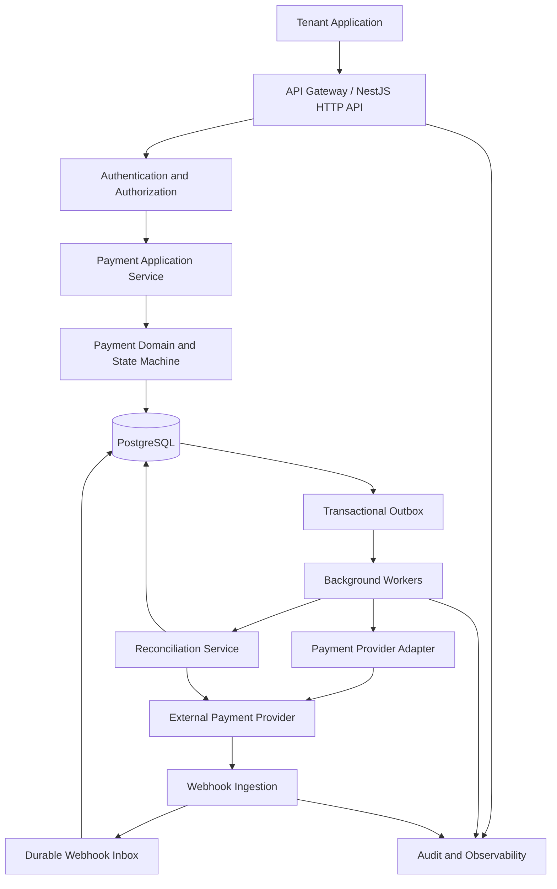

# 3. Engineering Principles

These principles are mandatory throughout development.

## 3.1 Modular monolith first

Build a modular NestJS application with explicit domain boundaries.

Do not introduce microservices solely to make the architecture appear more sophisticated.

Separate deployment processes may be used for the HTTP API, webhook ingestion, background workers, and scheduled reconciliation tasks while initially sharing the same codebase and PostgreSQL database.

## 3.2 PostgreSQL is the source of truth

Persist authoritative internal transaction state in PostgreSQL.

Do not use an in-memory cache, Redis, an external provider response, or a message broker as the only durable record of a financial operation.

External providers remain authoritative for their own processing outcomes. Baloot Pay must preserve the distinction between its local records and the provider's confirmed state.

## 3.3 Explicit domain behavior

Keep business rules inside application and domain services rather than controllers, Prisma middleware, or provider-specific HTTP handlers.

All state transitions must be validated by domain logic.

## 3.4 Fail closed

When authorization, webhook verification, amount validation, currency validation, or transaction ownership cannot be established, reject the operation or place it into a safe, explicitly defined recovery state.

Never guess a financial outcome.

## 3.5 Security and correctness before convenience

Do not weaken validation, remove authorization checks, bypass tests, or silently accept inconsistent financial data to make a feature easier to implement.

## 3.6 No unreviewed abstractions

Avoid speculative frameworks, unnecessary design patterns, and excessive indirection.

Every module and abstraction must serve a documented business or engineering requirement.

---

---

# 4. Technology Stack

| Layer | Technology | Responsibility |
|---|---|---|
| Language | TypeScript | Strongly typed application logic |
| Backend framework | NestJS | Modules, dependency injection, controllers and application services |
| Database | PostgreSQL | Durable transactional state |
| ORM | Prisma 8 | Database access, schema management and migrations |
| API documentation | OpenAPI / Swagger | Versioned API contracts |
| Validation | NestJS-compatible DTO validation | Input validation and strict request schemas |
| Authentication | Existing deployed multi-tenant authentication service; Baloot Pay validates its documented identity contract and enforces local resource authorization |
| Background processing | Durable queue or PostgreSQL-backed work queue | Asynchronous workflows and retries |
| Testing | Jest and HTTP integration testing | Unit, integration and end-to-end verification |
| API protection | Rate limiting, throttling and abuse controls | Resource and business-flow protection |
| Observability | Structured logs, metrics and distributed tracing | Operational diagnosis |
| Containers | Docker | Consistent build and deployment environments |
| CI/CD | Repository-supported pipeline | Automated verification and controlled releases |

### Existing Baloot Auth integration boundary

Baloot Pay uses the existing [Baloot Auth service](https://github.com/sajjadcodes/baloot-auth) for authentication; it must not recreate that service's registration, password, session, or credential lifecycle.

The current Baloot Auth documentation and implementation describe:

- Browser login and refresh using HttpOnly cookies. Tokens are not returned in response bodies or exposed to frontend JavaScript.
- Bearer access-token extraction as an alternative supported by its JWT strategy.
- Access tokens containing `sub`, `clientId`, and `sessionId`; the strategy checks the session and active/verified user against the Auth database on each authenticated request.
- An authenticated principal with `userId`, `clientId`, and `sessionId`. The documented `/auth/me` response exposes user ID and email.
- A public `X-Client-Id` header used to select an Auth client. It is not proof of identity and does not automatically identify a Baloot Pay business tenant.

This summary reflects the repository's current public [authentication API guide](https://github.com/sajjadcodes/baloot-auth/blob/main/docs/authentication-api.md), [security guide](https://github.com/sajjadcodes/baloot-auth/blob/main/docs/security.md), and [JWT strategy](https://github.com/sajjadcodes/baloot-auth/blob/main/src/auth/strategies/jwt.strategy.ts). Recheck these contracts against the deployed version before implementation.

These properties do not by themselves define a safe payment API integration contract. Before implementing the integration, confirm the deployed Auth version and Swagger contract, supported API caller types, how payment requests receive an authenticated principal, authorization/role claims available to payment APIs, and how an authenticated user maps to a payment tenant. In particular:

- Do not interpret Auth `clientId` as `tenantId` unless an explicit, reviewed mapping says they are the same.
- Do not share the Auth JWT signing secret, Auth database, or session tables with Baloot Pay as a shortcut.
- Do not trust `X-Client-Id`, tenant IDs, roles, or user IDs supplied by a caller without Auth-backed verification.
- Browser cookies are host-only in the documented setup. Do not assume a cookie sent to the Auth host is also sent to the payment API host. Select an approved same-origin gateway/BFF or other documented integration; preserve CSRF defenses for cookie-authenticated state-changing requests.
- The Auth service's bearer support does not establish a machine-to-machine credential-issuance contract. Confirm one before promising direct service-to-service access.
- If a remote Auth verification endpoint is selected, define bounded timeouts, fail-closed behavior, availability/load objectives, response validation, and a revocation-consistent caching policy. Do not cache revocation-sensitive authentication results without explicit approval.

An implementation may contain a narrow payment-service integration adapter/guard to consume the agreed Auth contract. That is not a replacement authentication module and must not duplicate Auth user, password, session, or credential ownership.

### Dependency policy

Use supported, mutually compatible versions and pin dependencies through the package manager's lockfile.

Do not install a new package when the existing stack can safely solve the problem.

Before selecting a queue implementation, authentication provider, payment SDK, or secrets manager, evaluate the actual operational requirements and deployment environment.

If Redis is introduced, it must not become the authoritative financial database.

---

---

# 5. High-Level Architecture



The diagram represents logical responsibilities, not a requirement to create separate microservices.

## 5.1 Architectural layers

### Presentation layer

Responsible for:

- HTTP controllers.
- Request DTOs and validation.
- Authentication and authorization integration.
- Response serialization.
- API versioning.
- Consistent error responses.

Controllers must not directly perform payment-provider calls or implement transaction state machines.

### Application layer

Responsible for:

- Creating payment operations.
- Enforcing business use cases.
- Coordinating database transactions.
- Applying idempotency rules.
- Scheduling durable asynchronous work.
- Calling domain services and provider interfaces.

### Domain layer

Responsible for:

- Payment state transitions.
- Money and currency invariants.
- Refund and capture rules.
- Domain validation.
- Business-level error definitions.
- Provider-independent transaction semantics.

The domain layer must not depend directly on NestJS HTTP objects or Prisma-generated database types.

### Infrastructure layer

Responsible for:

- Prisma repositories.
- PostgreSQL persistence.
- Provider SDKs and HTTP clients.
- Webhook signature verification.
- Queue and worker implementations.
- Secrets management integrations.
- Logging, metrics, tracing and external service integrations.

## 5.2 Dependency direction

Application and domain code must not depend on concrete provider SDKs.

Provider adapters implement interfaces owned by the application or domain boundary.

This allows the platform to add or replace a provider without rewriting its payment lifecycle.

---

---

# 6. Repository Structure

Use a structure similar to the following. Adapt existing repository conventions where they are sound.

```text
baloot-pay/
├── src/
│   ├── main.ts
│   ├── app.module.ts
│   ├── config/
│   │   ├── configuration.ts
│   │   ├── env.validation.ts
│   │   └── configuration.module.ts
│   ├── common/
│   │   ├── errors/
│   │   ├── validation/
│   │   ├── logging/
│   │   ├── security/
│   │   └── observability/
│   ├── modules/
│   │   ├── tenants/
│   │   │   ├── domain/
│   │   │   ├── application/
│   │   │   ├── infrastructure/
│   │   │   └── presentation/
│   │   ├── payments/
│   │   ├── payment-providers/
│   │   │   ├── contracts/
│   │   │   ├── registry/
│   │   │   └── adapters/
│   │   ├── refunds/
│   │   ├── webhooks/
│   │   ├── idempotency/
│   │   ├── transaction-events/
│   │   ├── outbox/
│   │   ├── reconciliation/
│   │   ├── audit/
│   │   └── health/
│   ├── workers/
│   └── database/
├── prisma/
│   ├── schema.prisma
│   ├── migrations/
│   └── seed.ts
├── test/
│   ├── unit/
│   ├── integration/
│   ├── e2e/
│   ├── contract/
│   ├── security/
│   └── fixtures/
├── docs/
│   ├── architecture/
│   ├── decisions/
│   ├── security/
│   ├── operations/
│   ├── api/
│   └── threat-model/
├── .github/
│   └── workflows/
├── .env.example
├── .gitignore
├── AGENTS.md
├── Dockerfile
├── docker-compose.yml
├── README.md
└── package.json
```

Do not create every directory as an empty placeholder. Introduce each module when its corresponding roadmap phase begins.

Each business module should have a clear public interface. Other modules must not reach into its private implementation or access its tables without a documented reason.

---
